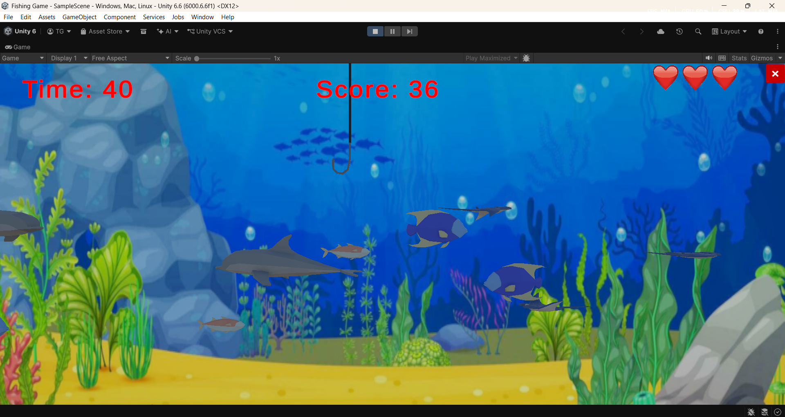
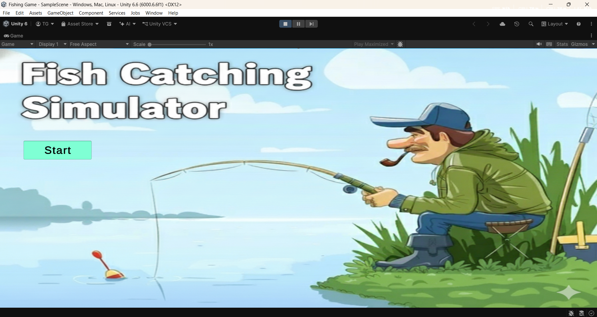
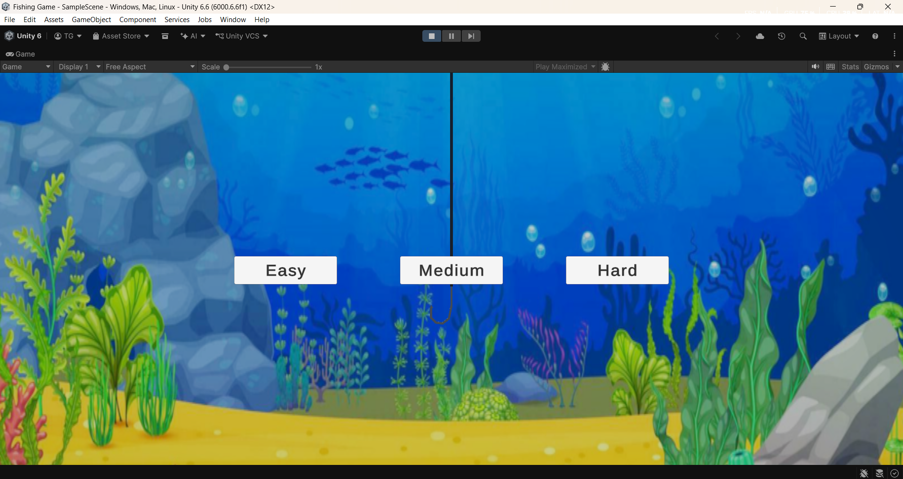
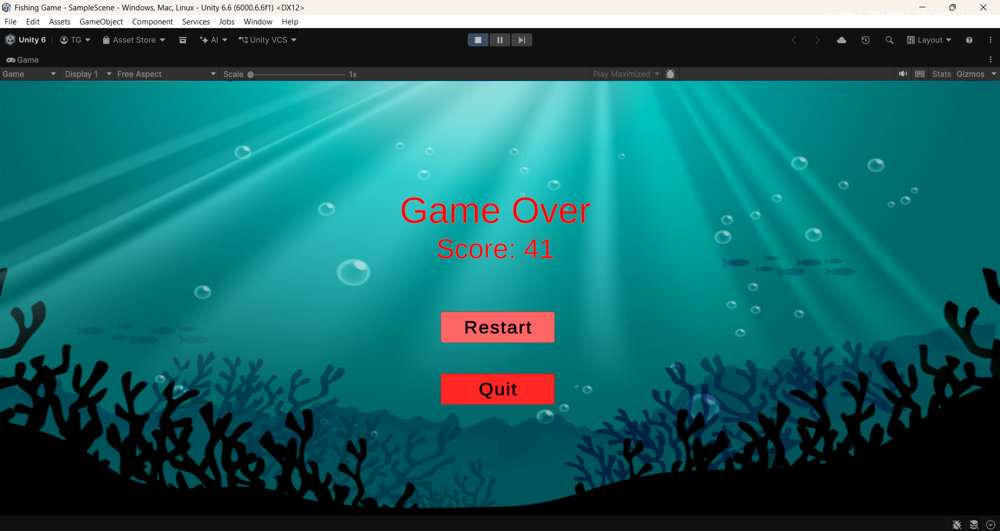

# 🎣 Fishing Game

A 2D fishing arcade game developed with **Unity and C#**. Catch fish, avoid dangerous sea creatures, earn points, and try to achieve the highest score before time runs out!

## 🎮 Gameplay Preview

<!-- Add your gameplay video link here -->
[▶ Watch Gameplay Video](YOUR_VIDEO_LINK_HERE)

<!-- Replace these placeholders with your actual screenshots -->

## ✨ Features

- **Three difficulty levels** – Easy, Medium, and Hard.
- **Fish spawning system** – Fish spawn at random intervals and move across the screen.
- **Mouse-controlled fishing hook** – Move the hook to interact with fish.
- **Different fish types** – Catch fish to earn points while avoiding dangerous creatures.
- **Lives system** – Hearts represent the player's remaining lives.
- **Countdown timer** – Complete the game within the time limit.
- **Score system** – Earn points by catching fish.
- **High-score saving** – Save the player's best score using Unity PlayerPrefs.
- **Audio integration** – Sound effects and background music.
- **Game screens** – Main menu, difficulty selection, gameplay, and game-over screens.
- **Restart functionality** – Play again after a game ends.

## 🕹️ Controls

| Input | Action |
|---|---|
| Mouse movement | Move the fishing hook |
| Mouse click | Attempt to catch a fish |

## 🛠️ Technologies Used

- **Game Engine:** Unity
- **Programming Language:** C#
- **UI:** Unity UI System
- **Text Rendering:** TextMeshPro
- **Version Control:** Git and GitHub

## 📸 Screenshots

### Main Menu

### Difficulty Selection

### Gameplay

### Game Over

## 🚀 Getting Started

### Requirements

- Unity Hub
- A compatible Unity Editor version
- Git (optional, for cloning the repository)

### Run the Project

1. Clone or download this repository.
2. Open Unity Hub.
3. Select **Add > Add project from disk**.
4. Select the downloaded project folder.
5. Open the project using a compatible Unity Editor version.
6. Open the main game scene.
7. Press the Play button in Unity.

> **Note:** Replace this section with the exact Unity version and main scene name used by your project.

## 📚 What I Learned

Through this project, I gained practical experience with:

- Developing gameplay systems using C# and Unity.
- Managing game states and UI screens.
- Using coroutines for timed events and fish spawning.
- Instantiating and managing game objects.
- Implementing scoring and player lives.
- Connecting audio to gameplay events.
- Organizing scripts and connecting components through the Unity Inspector.

## 🎥 Gameplay Video

[Watch the full gameplay demonstration](YOUR_VIDEO_LINK_HERE)

## 👨‍💻 Developer

Developed as part of my journey in learning game development with Unity and C#.

---

⭐ If you find this project interesting, feel free to explore the repository!